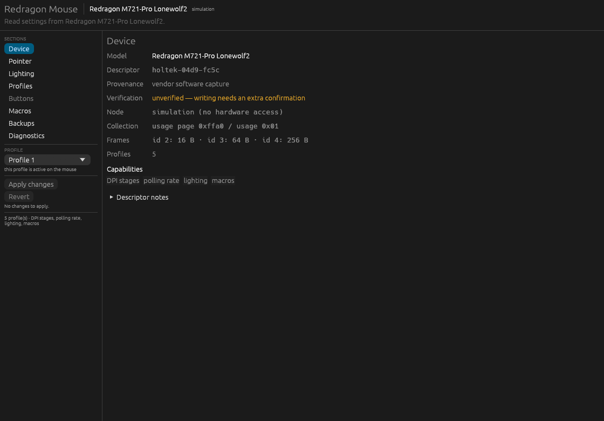
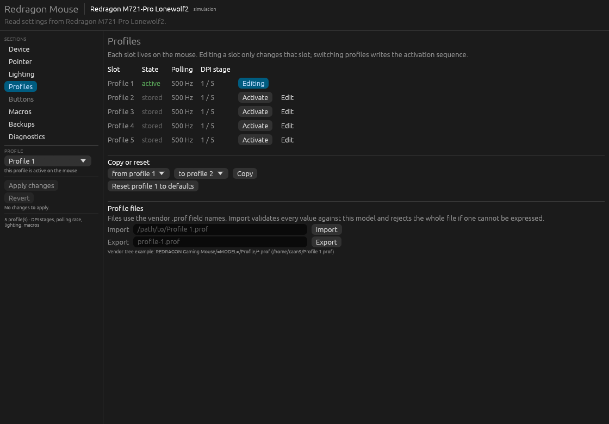
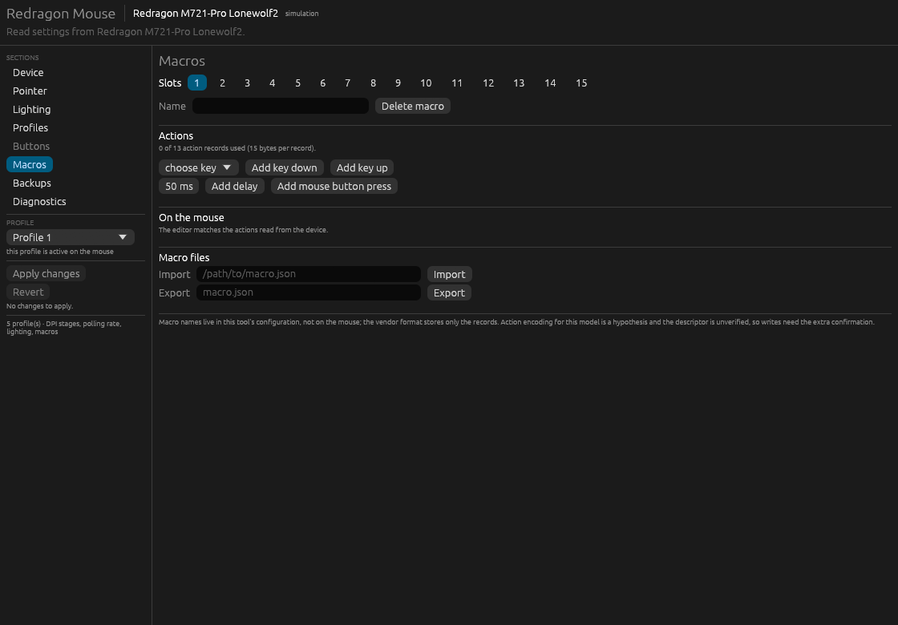

# Redragon Mouse for Linux

<p align="center">
  
</p>

**A native Linux configuration tool for Redragon/Holtek USB gaming mice** — DPI, polling rate, lighting, profiles, button mappings and macros, without the vendor's Windows application.

[](#license)
[](#requirements)
[](#build-from-source)
[](#supported-hardware)

`redragon-gui` speaks the mouse's HID feature-report protocol directly over `/dev/hidraw`. It
reads the current register state before showing anything editable, applies changes as a reviewed
transaction with a backup and read-back verification, and reports exactly what the mouse did — or
did not — accept.

> **Project status: alpha.** On a Redragon M721-Pro (`04d9:fc5c`) lighting (all eight effects,
> colour, speed, brightness), DPI stages and the active stage, polling rate and profile switching are
> verified on the real mouse by observing the effect, not only by read-back. Button remapping and
> macros are not implemented yet. The model's descriptor stays marked **unverified** for that
> reason, so every write requires an explicit risk acknowledgement. Details:
> [`docs/hardware-checkpoint.md`](docs/hardware-checkpoint.md).

## Contents

- [Why this exists](#why-this-exists)
- [Features](#features)
- [Supported hardware](#supported-hardware)
- [Safety model](#safety-model)
- [Requirements](#requirements)
- [Build from source](#build-from-source)
- [Install](#install)
- [Usage](#usage)
- [Screenshots](#screenshots)
- [Model descriptors](#model-descriptors)
- [Project layout](#project-layout)
- [Testing](#testing)
- [Known limitations](#known-limitations)
- [Documentation](#documentation)
- [Contributing](#contributing)
- [License and provenance](#license-and-provenance)

## Why this exists

The vendor configuration application is a Windows-only binary that reaches the mouse through
Windows' HID stack. On Linux the mouse is already fully usable: the kernel exposes its vendor
interface as a plain `/dev/hidraw` node, and every setting is an ordinary HID feature report. What
was missing was a tool that treats that protocol as what it is — a memory-mapped register file with
real consequences — instead of a set of magic writes.

This project provides that tool, plus the reverse-engineering notes and hardware checkpoint behind
its model data. It is not a wrapper around the Windows application and does not require Wine, a
kernel module, `libusb`, or root.

## Features

- **Read-back-first configuration.** Nothing is shown as a device value unless it was read from the
  device in this session, twice, with matching results.
- **Reviewed, verified writes.** A change is shown as a before/after register diff, backed up,
  written inside a configuration session followed by the vendor's refresh frames, and then read back. Mismatches are reported as
  "not confirmed" and never presented as success.
- **Automatic backup and restore.** Every apply stores the pre-change values as timestamped JSON;
  restore replays through the same validated path.
- **Data-driven model support.** A TOML descriptor declares the register windows, write regions,
  encoding tables, capabilities and provenance. Adding a model is a data change, validated at load.
- **Honest capability reporting.** Unsupported features are absent or explained, unreadable
  registers mark the device read-only, unknown register codes are preserved rather than guessed.
- **Editors** for DPI stages and polling, lighting (effect, RGB/HSV/hex, brightness, zones),
  profiles (activate, copy, reset, vendor `.prof` import/export), buttons (actions, keys, combos),
  macros (ordered actions, burst fire, portable files), and backups.
- **Diagnostics without privilege escalation.** Missing access prints the node path, mode, owner,
  and the exact udev rule; the application never asks for or uses elevated privileges.
- **CLI and simulation.** Headless device listing, raw/decoded state dumps, report-descriptor dump,
  and a full GUI simulation mode for working without hardware.
- **Hotplug-aware.** Disconnects keep pending edits; reconnects re-read the device and warn before
  those edits are applied.

## Supported hardware

| Device | USB ID | State | Notes |
|---|---|---|---|
| Redragon M721-Pro "Lonewolf2" | `04d9:fc5c` | Lighting, DPI, polling and profile switching verified on hardware; descriptor **unverified** | Button keymaps, macros and global pointer settings not declared |
| Other Redragon/Holtek models | — | Not supported yet | Add a descriptor after capturing the model (see [Model descriptors](#model-descriptors)) |

The attached device was identified as an M721-Pro by its USB ID and the vendor data tree; the
report-descriptor facts (vendor page `0xFFA0`, feature reports 2–6) were read from the hardware.

## Safety model

A configuration write to the wrong register can make a mouse awkward or impossible to use. The
tool is built around that risk:

1. **Read twice.** Every declared register window is read twice; the images must match and must not
   be all-zero/all-`0xFF` filler. Otherwise the device is read-only.
2. **Validate everything.** Enumerated values, ranges, address bounds, descriptor tables and macro
   limits are checked before the first frame. Invalid state sends nothing.
3. **Review the change set.** Apply lists every register with its before and after values. An
   unverified descriptor adds a one-time risk acknowledgement per session.
4. **Detect external changes.** The targeted registers are re-read before writing; if they changed
   since the baseline, the apply is refused until you explicitly choose "write anyway".
5. **Back up first.** A timestamped JSON backup of the pre-apply values is written before any
   frame is sent.
6. **Write transactionally.** One session (`F5 00` ... `F5 01`) per phase, the vendor's refresh
   sequence after the writes, and the documented pacing; a mid-transaction failure triggers a
   rollback of the registers already written. The closing frame is always sent.
7. **Verify by read-back.** Every written register is read back and compared. The report names any
   register that was not confirmed.
8. **Never escalate.** Access problems are explained; the tool does not run `sudo`, install files,
   or modify system state.

If something does go wrong, restore the backup from the Backups screen. If the mouse is
unresponsive, reconnect it; the configuration persists. The vendor application or a firmware
reflash is the last resort.

## Requirements

- Linux with `hidraw` (any current kernel) and `udev`.
- A Rust toolchain, 1.95 or newer, to build (egui 0.37 requires it).
- For the GUI: an X11 or Wayland session with an OpenGL-capable driver (the `glow` renderer).
- Read/write access to the mouse's **vendor interface** (`/dev/hidrawN`), normally granted by a
  udev rule.

No kernel module, `libusb` package, or root session is required at runtime.

## Build from source

```sh
git clone https://github.com/sekhnat/redragon-mouse-linux.git
cd redragon-mouse-linux
cargo build --release
```

The result is a single binary at `target/release/redragon-gui`.

## Install

### AppImage

Every push to `main` builds an AppImage in CI (Actions → *AppImage* → artifacts) and every `v*` tag
publishes one, with its `SHA256SUMS`, to the GitHub release:

```sh
chmod +x redragon-gui-*-x86_64.AppImage
./redragon-gui-*-x86_64.AppImage --list-devices
```

The image bundles the binary and the model descriptors and uses your system's OpenGL, Wayland or
X11 libraries. It cannot install the udev rule, so do that once (the rule is published next to the
image and is also inside it: `./redragon-gui-*.AppImage --appimage-extract usr/share/redragon-gui`):

```sh
sudo install -Dm644 99-redragon-gui.rules /etc/udev/rules.d/
sudo udevadm control --reload-rules && sudo udevadm trigger
```

Build one locally with `packaging/build-appimage.sh` (needs `curl`, and `rsvg-convert` or
ImageMagick); the result is `dist/redragon-gui-<version>-x86_64.AppImage`. Without FUSE, run it
with `APPIMAGE_EXTRACT_AND_RUN=1`.

### From a source build

```sh
sudo install -Dm755 target/release/redragon-gui /usr/local/bin/redragon-gui
sudo install -Dm644 models/*.toml -t /usr/local/share/redragon-gui/models/
sudo install -Dm644 assets/99-redragon-gui.rules /etc/udev/rules.d/
sudo install -Dm644 assets/redragon-gui.desktop /usr/local/share/applications/
sudo install -Dm644 assets/redragon-gui.metainfo.xml /usr/local/share/metainfo/
sudo install -Dm644 assets/redragon-gui.svg /usr/local/share/icons/hicolor/scalable/apps/
sudo udevadm control --reload-rules && sudo udevadm trigger
```

Reconnect the mouse, then check:

```sh
redragon-gui --list-devices
```

The shipped rule uses `TAG+="uaccess"`. On systems where logind does not apply the ACL to the
hidraw node — verify with `getfacl /dev/hidrawN` — add `GROUP="users"` to the rule (your user must
be in that group), or grant a session ACL:

```sh
sudo setfacl -m u:$USER:rw /dev/hidrawN
```

The application prints the exact rule it needs, including the node, its mode and its owner.

## Usage

```sh
redragon-gui                              # graphical interface
redragon-gui --list-devices               # HID interfaces, supported/unsupported
redragon-gui --dump-state                 # decoded settings
redragon-gui --dump-raw                   # raw register windows (diagnostics)
redragon-gui --report-descriptor          # HID report descriptor, collections, report sizes
redragon-gui --show-descriptor [MODEL]    # print a model descriptor
redragon-gui --simulate holtek-04d9-fc5c  # full interface without hardware
```

| Exit code | Meaning |
|---|---|
| `0` | Success |
| `1` | Error (arguments, descriptor, I/O) |
| `2` | No supported device found |
| `3` | The configuration interface cannot be opened (access guidance printed) |

The interface has eight sections:

| Section | Contents |
|---|---|
| **Device** | Model, IDs, node, descriptor provenance, capabilities, access guidance, last apply report |
| **Pointer** | Five DPI stages (enable, value, X/Y link where supported, active stage), polling rate, global pointer settings where declared |
| **Lighting** | Effect, colour (RGB/HSV/hex), brightness, effect speed, zones where declared |
| **Profiles** | Five onboard slots: activate, copy, reset; vendor `.prof` import/export |
| **Buttons** | Per-button action, key, macro slot and combo editor; primary-click guard |
| **Macros** | Library, ordered actions with delays, burst fire, portable JSON files |
| **Backups** | Restore a recorded register set through the verified path |
| **Diagnostics** | Log path, descriptor load problems, access guidance, apply report |

Pending edits are kept in a draft, survive a disconnect, and reach the mouse only when you apply.

## Screenshots

| Profiles | Macros |
|---|---|
|  |  |

Screenshots are from simulation mode, so no hardware identifiers or user paths are shown.

## Model descriptors

A descriptor is declarative data: vendor collection, feature-report table, read windows, write
regions, per-feature encodings, tables (DPI codes, keycodes, LED modes/zones, buttons), limits,
provenance, and a `verified` flag. See
[`models/holtek-04d9-fc5c.toml`](models/holtek-04d9-fc5c.toml) for a commented example and
[`models/00-registry.toml`](models/00-registry.toml) for the registry.

```toml
[[frames]]
id = 2
len = 16

[windows.profile_page]
report = 3
count = 5
len = 32
addrs = [0x0042, 0x0102, 0x01b2, 0x0262, 0x0312]
```

Descriptors are loaded from the data directory (`/usr/local/share/redragon-gui/models/` or
`models/` in a checkout), validated semantically at load, and never compiled in. A malformed file
is reported in Diagnostics and skipped without affecting other models.

## Project layout

```
src/
  transport/   feature-report frames, hidraw ioctl backend, in-memory simulator
  device/      sysfs enumeration, report-descriptor parser, access diagnostics
  models/      descriptor schema, registry, semantic validation, test fixture
  settings/    register image, typed views, diff, transaction engine, backups, file formats
  ui/          egui shell and one module per section
models/        registry + per-model TOML descriptors
assets/        udev rule, desktop entry, AppStream metadata, icon
packaging/     AppImage build script (shared by CI and local builds)
.github/       CI (fmt, clippy, tests, MSRV) and the AppImage workflow
tests/         simulation, CLI contract, ignored hardware round-trip
docs/          reverse-engineering report and hardware checkpoint
openspec/      change proposal, specs, design and task record
```

The `transport` and `settings` layers are UI-free; the UI is a rendering layer over a baseline and
a draft. `unsafe` is limited to the `libc` seams for hidraw ioctls and locking.

## Testing

```sh
cargo test                         # unit, simulation and CLI tests (no hardware)
cargo clippy --all-targets -- -D warnings
cargo fmt --check
```

The default suite covers frame vectors, report-descriptor parsing, registry resolution, descriptor
validation, state round-trips, transactional apply (stale refusal, verification mismatch,
mid-transaction rollback), backup replay, profile and macro files, hotplug events, and a headless
render of every screen.

One optional test talks to the physical mouse and is **ignored by default**:

```sh
REDRAGON_GUI_ALLOW_WRITE=1 cargo test --test hardware -- --ignored --nocapture
```

It changes one LED brightness value on a non-active profile, verifies it by read-back, restores the
backup, and verifies the restore. Read-back only proves a register was stored; the firmware also
needs the session and refresh frames, so check lighting, DPI and profile changes by eye (and polling
by counting reports, as in the hardware checkpoint). It refuses to run without the environment variable.

## Known limitations

- **Button remapping is unavailable on this model.** The keymap lives at `0x82 + 4·slot` per
  profile and the vendor's function codes are known (`81` left, `82` right, `83` middle, ...), but
  the slot order and the keyboard/combo encodings are not decoded, so no keymap registers are
  declared and the Buttons screen explains this.
- **Global pointer settings are unavailable on this model** (angle snap, lift-off distance, scroll
  speed/page, acceleration, double-click), because their registers are not pinned.
- **Burst fire is unavailable on this model** (no burst register is declared).
- **Macros are unavailable on this model.** The record encoding at `0x478 + 200·slot` is not
  decoded, so the model declares no macro section rather than writing guessed bytes.
- **`.prof` interoperability is approximate.** The tool round-trips its own exports and reads the
  documented field names, but vendor action codes and some fields differ.
- **Other models need captures.** Adding one is data-only, but the descriptor must be written from
  evidence.
- **The `04d9:fc5c` descriptor stays unverified** until buttons and macros are decoded, so every
  write requires the risk acknowledgement in the GUI.
- **Scripted writes** use `redragon-gui --set KEY=VALUE` (for example `--set led.1.mode=wave`,
  `--set dpi.1.4=1600`, `--set poll.1=1000`, `--set profile=2`) and refuse to run without
  `REDRAGON_GUI_ALLOW_WRITE=1`.
- **Packaging and project metadata are unfinished** (no AUR/Flatpak/CI; the AppStream URL is a
  placeholder).
- **egui's accessibility is weaker than GTK's.** Keyboard navigation and focus are implemented;
  screen-reader parity is not.
- **The original reverse-engineering report predates the hardware checkpoint.** Where it says
  `0xFF00` or "report 4 = 1024 B", the checkpoint and descriptor reflect the hardware:
  `0xFFA0`, report 2/3/4 = 16/64/256 B, and 1024 B as report 5.

## Documentation

- [`docs/hardware-checkpoint.md`](docs/hardware-checkpoint.md) — report descriptor, raw register
  dumps, read/write sequences, detach/reconnect, verification decision.
- [`docs/redragon-gaming-mouse-re.md`](docs/redragon-gaming-mouse-re.md) — reverse-engineering report
  for the vendor application and protocol. The proprietary Windows package it analyses is **not**
  included in this repository.
- [`openspec/changes/add-redragon-mouse-gui/`](openspec/changes/add-redragon-mouse-gui/) — proposal,
  capability specs, design decisions and task record for the implementation.

## Contributing

Captures are the most valuable contribution: a descriptor or a confirmed table entry with its
provenance. Before opening a pull request, run the commands under [Testing](#testing), keep
descriptors evidence-based (no interpolated values), and mark anything not confirmed on hardware as
`verified = false`.

## License and provenance

Licensed under either of [MIT](LICENSE-MIT) or [Apache-2.0](LICENSE-APACHE), at your option.

The protocol facts in the descriptors and documentation come from this project's own
reverse-engineering report and from read-only observation of the hardware; HID usage IDs follow the
USB HID specification. No code or captured tables from `mouse_m908` (GPL-3.0) or other projects were
copied. The vendored Windows application and its Qt/HID libraries are proprietary and are not
distributed with this repository.
